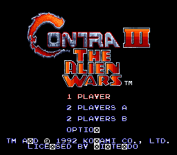

# Assets

The graphics, the compressed streams the game decompresses to WRAM and the
sound CPU data are not `.byte` lines in `src/`: each block is a file under
`assets/`, included with `.incbin` right after its label. This page gives
the layout, what was moved and what was left inline, and why.

## Layout

```
assets/manifest.txt         every asset: its path and how the build makes it
assets/gfx/<label>.bin      graphics (VRAM streams, td_sprite_tiles_16)
assets/wram/<label>.bin     streams decompressed to WRAM
assets/sound/<label>.bin    sound CPU data
build/assets/<dir>/<label>.lz   the compressed streams, made by the build
```

The file is named after the label of the block; the label stays in the
`.asm` file, with its comments, right before the include:

```
gfx_0891DE:
	; ASSET: compressed graphics (VRAM), $08:91DE-$08:9224 (from its length word), loaded by load_list_0587AB
	.incbin	"gfx/gfx_0891DE.lz"
```

A compressed stream is stored **decompressed**: `assets/gfx/gfx_0891DE.bin`
holds the 512 bytes the game decompresses to VRAM, and the build compresses
them into `build/assets/gfx/gfx_0891DE.lz` with `tools/c3lz.py`. The
`.lz` file is the whole stream, its length word included, so the size of
the stream in the ROM is whatever the compressor makes of the data.

`assets/manifest.txt` says which encoder version reproduces each stream
(the game's encoder came in two versions, see
[Compression](compression.md#two-versions)), one line per asset:

```
gfx/gfx_0891DE                   lz-v2
gfx/gfx_088FD4                   lz-v1
sound/spc_block_1D8002           raw
```

- `lz-v1`, `lz-v2`: the source includes `<path>.lz`, compressed from
  `assets/<path>.bin` with that version;
- `raw`: the source includes `<path>.bin`, the file as it is (the
  uncompressed sound blocks and `td_sprite_tiles_16`).

ca65 looks the included path up in `assets/`, then in `build/assets/`:
every assembly of `src/` passes `--bin-include-dir assets
--bin-include-dir build/assets`. In the `Makefile`, `build/assets.mk`
(written by `python3 tools/assets.py makefile` from the manifest) has one
rule per compressed stream, from its `.bin` and the two tools, and the
streams (`asset_targets`) are dependencies of `build/main.o`: editing a
`.bin` recompresses that stream only and reassembles. `make assets` makes
them alone. The tools that assemble `src/` themselves
(`tools/srcmap.py`, `tools/cheats.py`, `tools/shift.py`) go through
`ca65_args` in `tools/assets.py`, which first makes the streams that are
out of date. Making all 179 takes a few seconds (`make -j` runs them in
parallel).

Why binary files and not `.inc` files of `.byte` lines: the bytes are the
data itself, with no labels, pointers or expressions in them, so a text
form adds nothing but size, and a binary file is what any graphics or
compression tool reads and writes. `.incbin` is ca65's include for such a
file.

## What was moved

A block was moved only if its start and end are certain and nothing else
reads into it or past it:

- the start is a label that the data lists point to (`load_vram`,
  `load_wram`, `load_spc`, `load_spc_raw`) or that the `td_tiles` records
  use;
- the end comes from the data: a compressed stream starts with its length
  (the decompressor stops there); an uncompressed sound block has its size
  in its `load_spc_raw` entry; the raw sprite
  tiles `td_sprite_tiles_16` are `$1800` bytes, the end of the last
  `td_tiles` record that uses them (`+$1700`, `$100` bytes);
- the block's `.byte` lines hold only those bytes (no code, no other label,
  no `LAYOUT` comment saying that something reads across its bounds).

That is 199 blocks, 709,486 bytes in the ROM:

| assets | blocks | in the ROM | stored |
|---|---|---|---|
| `gfx/`, compressed | 98 | 376,310 | 549,343 decompressed |
| `gfx/`, `td_sprite_tiles_16` | 1 | 6,144 | 6,144 |
| `wram/`, compressed | 70 | 172,344 | 321,032 decompressed |
| `sound/`, compressed | 11 | 43,951 | 59,454 decompressed |
| `sound/`, uncompressed | 19 | 110,737 | 110,737 |

Of the 179 streams, 40 need `lz-v1` and 139 are made with `lz-v2` (66 of
these come out the same with either).

The two bytes that follow some sound blocks on the same `.byte` line (the
size or address word of the next block) stay inline after the include. A
CDL comment that fell inside a block is kept above the include with its
offset (`; from +$1600: CDL: not accessed`).

The WRAM streams are moved too although what they decompress to is not
checked for pointers yet: the compressed bytes cannot hold a label either
way, so moving them to a file changes nothing for shifting.

## What stays inline, and why

- `gfx_07E9FE`: `draw_td_item_metasprite` reads one byte past the last
  sprite of the metasprite before, which is the first byte of this
  stream's length word (its `LAYOUT` comment). Changing the stream's size
  would change that byte.
- `gfx_14DC62`: the last `td_tiles` record of the centipede DMAs `$100`
  bytes from `td_sprite_tiles_14 + $1F80`, `$80` of them from the start of
  this stream.
- `td_sprite_tiles_14`: for the same reason (a record reads past its end).
- `td_sprite_tiles_13`: the `td_tiles` records only use its first `$A00`
  bytes; the `$1600` bytes after them are not referenced, so where the
  block really ends is not known.
- The palettes of bank `$08` and the other tables: they are not marked
  `ASSET` (palettes overlap: some labels are inside the palette before),
  and banks `$05`-`$07` hold pointers.

## Shifting

The assets move with their banks like the bytes did: the label is in the
source, the file is only its contents. `tools/shift.py build --labels`
also inserts a filler byte before labels that follow an `.incbin` (through
a small macro, `shift_incbin_filler`, that it adds to its copy of
`main.asm`), so assets move relative to each other in the shift test too.

## Editing an asset

Edit the `.bin` (or replace it) and run `make`. The stream is
recompressed with the version the manifest gives; if it comes out longer
or shorter, everything after it in its bank moves, which the source
allows since every reference to it is a label (milestone 3). The ROM is
then no longer the original, so `make` reports a `MISMATCH` against
`contra3.sha1` (`make build/contra3.sfc` builds without the check); run it
in the emulator with `make emu-test` (the screenshots that show the edited
graphic will differ from the goldens, the plays should pass).

What the build does not check: the decompressed size. The game
decompresses a stream to the address in its data list until the stream
ends; a larger asset overwrites whatever follows it in VRAM or WRAM. Keep
the size unless you know what is there.

An example, done in a throwaway copy of the repository: in the 2bpp font
`assets/gfx/gfx_089D7E.bin` (loaded at VRAM `$5000` for BG3), tile 73,
the letter N (bytes `$490`-`$49F`), replaced by a framed box with a
cross. The stream went from 1,978 to 1,977 bytes, so the 10 labels after it
in bank `$08` (`gfx_08A538` to the end of the bank) moved down by one
byte. The ROM built, `tools/shift.py build --labels 0.3 --seed 1` built a
shifted copy of it, and both run: the title screen of the shifted ROM, with
the new N in `OPTION` and the copyright lines:



With goldens taken from the edited ROM (`--update-goldens`, in that copy),
the emulator suite's screenshots and scripted plays (`tests/test_screens.py`,
`tests/test_play.py`, 29 tests) pass on the shifted copy: moving the bank
after the edited stream changes nothing on screen.
