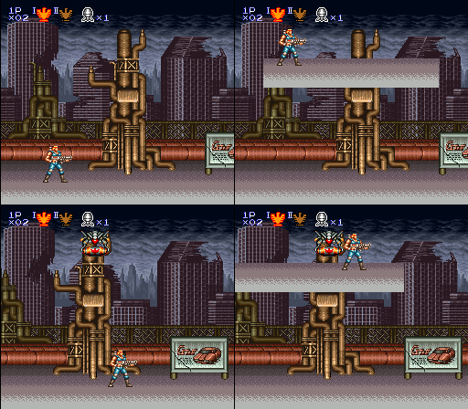

# Assets

The graphics, the compressed streams the game decompresses to WRAM and the
sound CPU data are not `.byte` lines in `src/`: each block is a file under
`assets/`, included with `.incbin` right after its label. The graphics are
indexed PNGs that the build converts back to the game's tile format and
compresses, byte for byte the original; the palettes and the tilemaps are
text files (GIMP palettes, grids of hex numbers) that it converts the same
way. This page gives the layout, the formats, how to edit a graphic, a
palette or a tilemap, and what was left as it was, and why.

## Layout

```
assets/manifest.txt          every asset: its path and how the build makes it
assets/gfx/<label>.png       graphics (VRAM streams, td_sprite_tiles_16)
assets/gfx/<label>.tilemap   tilemaps loaded to VRAM (text)
assets/wram/<label>.png      graphics decompressed to WRAM, copied to VRAM later
assets/wram/<label>.map     the stages' maps, decompressed to WRAM (text)
assets/wram/<label>.metatiles  side-view metatile definitions (text)
assets/wram/<label>.blocks   top-down block definitions (text)
assets/sound/spc_driver.s    the sound driver (SPC700 assembly, tools/spcasm.py)
assets/sound/spc_sfx.seq     its sound effects (sequences as text, included by spc_driver.s)
assets/sound/<label>.seq     the songs (sequences as text)
assets/sound/spc_samples_<bank>.txt  sample lists: the samples of a block, their loops
assets/sound/samples/<name>.brr      the sound samples (BRR), one per file
assets/palettes/<label>.gpl  palettes (GIMP palettes)
assets/views.txt             how the gallery shows them (viewing only)
build/assets/<dir>/<label>.bin   the bytes of a PNG, palette or tilemap, made by the build
build/assets/<dir>/<label>.lz    the compressed streams, made by the build
```

The file is named after the label of the block; the label stays in the
`.asm` file, with its comments, right before the include:

```
gfx_0891DE:
	; ASSET: compressed graphics (VRAM), $08:91DE-$08:9224 (from its length word), loaded by load_list_0587AB
	.incbin	"gfx/gfx_0891DE.lz"
```

A compressed stream is stored **decompressed**: `assets/gfx/gfx_0891DE.tilemap`
holds the 512 bytes the game decompresses to VRAM (a tilemap, as text), the
build converts them back to `build/assets/gfx/gfx_0891DE.bin` and compresses
them into `build/assets/gfx/gfx_0891DE.lz` with
`tools/c3lz.py`. The `.lz` file is the whole stream, its length word
included, so the size of the stream in the ROM is whatever the compressor
makes of the data. A graphic is stored as a PNG: the build converts
`assets/gfx/gfx_089D7E.png` to the font's tiles in
`build/assets/gfx/gfx_089D7E.bin` (`tools/snesgfx.py`), then compresses
those.

`assets/manifest.txt` says how each asset is made, one line per asset:

```
gfx/gfx_0891DE                   lz-v2  tilemap=bg
gfx/gfx_089249                   lz-v1  png=mode7 tiles=118 tail=00
gfx/gfx_089D7E                   lz-v2  png=2bpp tiles=253
sound/spc_song_ending            raw
sound/spc_samples_stage1         raw    brr=list
sound/spc_sample_dir_stage1      raw    dir=sound/spc_samples_common,sound/spc_samples_stage1
```

- `lz-v1`, `lz-v2`: the source includes `<path>.lz`, compressed from the
  data with that version of the game's encoder (it came in two versions,
  see [Compression](compression.md#two-versions));
- `raw`: the source includes `<path>.bin`, the data as it is (the
  uncompressed sound blocks and `td_sprite_tiles_16`);
- without `png=`, the data is `assets/<path>.bin`; with `png=FORMAT`, it
  is the first `tiles` tiles of `assets/<path>.png` in that format, followed
  by the bytes that `tail` gives in hex (see [Graphics](#graphics-png));
- with `gpl=LAYOUT`, it is the palette `assets/<path>.gpl` (see
  [Palettes](#palettes-gimp-gpl)); with `tilemap=FORMAT`, the tilemap text
  `assets/<path>.tilemap` (see [Tilemaps](#tilemaps));
- with `brr=list`, it is the BRR samples that the sample list
  `assets/<path>.txt` names, one after the other; with `dir=PATH,...`, the
  sound CPU's sample directory made from those sample lists (see
  [Sound: samples](sound.md#samples)); with `seq=text`, the song
  `assets/<path>.seq` assembled (see
  [Sound driver: songs as text](sound-driver.md#songs-as-text)); with
  `asm=spc700`, the SPC700 assembly `assets/<path>.s` assembled by
  `tools/spcasm.py` (the sound driver, which includes its sound effects'
  `.seq`; see [Sound driver: the driver's source](sound-driver.md#the-drivers-source));
- with `level=FORMAT`, the level text `assets/<path>.metatiles`,
  `.blocks` or `.map` (see [Level maps](#level-maps-text));
- `max=`: the most bytes the data may have (hex, `max=$0400`), what fits
  where the game puts it (see [Size limits](#size-limits)).

ca65 looks the included path up in `assets/`, then in `build/assets/`:
every assembly of `src/` passes `--bin-include-dir assets
--bin-include-dir build/assets`. In the `Makefile`, `build/assets.mk`
(written by `python3 tools/assets.py makefile` from the manifest) has one
rule per made file (tiles from a PNG, a stream from its data; each also
depends on the three tools), and the made files (`asset_targets`) are
dependencies of `build/main.o`: editing a PNG or a `.bin` remakes that
asset only and reassembles. `make assets` makes them alone. The tools that
assemble `src/` themselves (`tools/srcmap.py`, `tools/cheats.py`,
`tools/shift.py`) go through `ca65_args` in `tools/assets.py`, which first
makes what is out of date. Making everything takes about ten seconds
(`make -j` runs the rules in parallel). The build needs only Python's
standard library.

Why binary files and not `.inc` files of `.byte` lines: the bytes are the
data itself, with no labels, pointers or expressions in them, so a text
form adds nothing but size, and a binary file is what any graphics or
compression tool reads and writes. `.incbin` is ca65's include for such a
file.

## What was moved

A block was moved only if its start and end are certain and nothing else
reads into it or past it:

- the start is a label that the data lists point to (`load_vram`,
  `load_wram`, `load_spc`, `load_spc_raw`) or that the `td_tiles` records
  use;
- the end comes from the data: a compressed stream starts with its length
  (the decompressor stops there); an uncompressed sound block has its size
  in its `load_spc_raw` entry; the raw sprite
  tiles `td_sprite_tiles_16` are `$1800` bytes, the end of the last
  `td_tiles` record that uses them (`+$1700`, `$100` bytes);
- the block's `.byte` lines hold only those bytes (no code, no other label,
  no `LAYOUT` comment saying that something reads across its bounds).

That is 199 blocks, 709,486 bytes in the ROM:

| assets | blocks | in the ROM | stored |
|---|---|---|---|
| `gfx/`, compressed | 98 | 376,310 | 549,343 decompressed |
| `gfx/`, `td_sprite_tiles_16` | 1 | 6,144 | 6,144 |
| `wram/`, compressed | 70 | 172,344 | 321,032 decompressed |
| `sound/`, compressed | 11 | 43,951 | 59,454 decompressed |
| `sound/`, uncompressed | 19 | 110,737 | 110,737 |

Of the 179 streams, 40 need `lz-v1` and 139 are made with `lz-v2` (66 of
these come out the same with either).

The two bytes that follow some sound blocks on the same `.byte` line (the
size or address word of the next block) stay inline after the include;
for an uncompressed sound block, that word and the size in its
`load_spc_raw` entries are now `<label>_size`, set after its include, so
it may change size. A
CDL comment that fell inside a block is kept above the include with its
offset (`; from +$1600: CDL: not accessed`).

The WRAM streams are moved too although what they decompress to is not
checked for pointers yet: the compressed bytes cannot hold a label either
way, so moving them to a file changes nothing for shifting.

Later, by the same rule: 48 palettes (3,908 bytes in the ROM, see
[Palettes](#palettes-gimp-gpl)), and the 18 tilemaps among the streams
above became text files (see [Tilemaps](#tilemaps)).

## What stays inline, and why

- `gfx_07E9FE`: `draw_td_item_metasprite` reads one byte past the last
  sprite of the metasprite before, which is the first byte of this
  stream's length word (its `LAYOUT` comment). Changing the stream's size
  would change that byte.
- `gfx_14DC62`: the last `td_tiles` record of the centipede DMAs `$100`
  bytes from `td_sprite_tiles_14 + $1F80`, `$80` of them from the start of
  this stream.
- `td_sprite_tiles_14`: for the same reason (a record reads past its end).
- `td_sprite_tiles_13`: the `td_tiles` records only use its first `$A00`
  bytes; the `$1600` bytes after them are not referenced, so where the
  block really ends is not known.
- Six palette blocks of bank `$08` (see
  [Palettes](#palettes-gimp-gpl)), and the tables: banks `$05`-`$07` hold
  pointers.

## Graphics (PNG)

110 assets are graphics whose format is known, stored as indexed PNGs:

| format | assets | what |
|---|---|---|
| `4bpp` | 74 VRAM streams, `td_sprite_tiles_16`, 26 WRAM streams | BG1/BG2 characters and sprites: 32 bytes per 8x8 tile, 16 colours |
| `2bpp` | 1 (`gfx_089D7E`, the font) | BG3 characters: 16 bytes per tile, 4 colours |
| `mode7` | 5 VRAM streams (`gfx_089249`, `gfx_13CC02`, `gfx_148000`, `gfx_158000`, `gfx_168000`), 3 WRAM streams (`stage1_bomber_m7_chars`, `stage2_boss_m7_chars`, `stage5_boss_m7_chars`) | Mode 7 characters: 64 bytes per tile, one byte per pixel, 256 colours |

`tools/snesgfx.py` converts both ways. The SNES planar formats (`2bpp`,
`4bpp`, `8bpp`) store a tile's rows as bitplane pairs (planes 0 and 1 in
bytes 0-15, row by row, then planes 2 and 3, ...), the leftmost pixel in
bit 7; `mode7` is the high bytes of Mode 7 VRAM, one pixel per byte. A PNG
is 16 tiles (128 pixels) wide, the tiles in order left to right, top to
bottom, as they are in VRAM; the last row is padded with tiles of colour 0.
Each pixel's value in the PNG *is* the colour index in the data.

How the format of each was worked out, from where it is loaded:

- the data lists give each VRAM stream's destination. In the side-view
  stages (`stage_setup_video`: BG12NBA `$00`, BG34NBA `$05`, OBSEL `$03`,
  BG Mode 1) words `$0000`-`$3FFF` are BG1/BG2 characters (4bpp),
  `$4000`-`$4FFF` the BG1/BG2 tilemaps, `$5000`-`$5BFF` BG3 characters
  (2bpp), `$5C00`-`$5FFF` its tilemap and `$6000`-`$7FFF` sprite
  characters (4bpp). The title and the other screens (`init.asm`:
  BG12NBA `$22`, BG34NBA `$55`) have their tilemaps at `$0000`-`$1FFF`
  and characters from `$2000`; the lists of the attract sequence, the
  title, the stage intro screens (`load_list_058808` to `load_list_058868`,
  `load_list_058976`) and `load_list_05CF41` use that layout. The
  top-down stages (Mode 7) have their sprites at `$4000`-`$7FFF`;
- a list of type 3 loads one byte of each VRAM word (`load_vram_byte_list`):
  flags bit 0 clear, the high bytes, which in Mode 7 are the characters
  (`mode7`); bit 0 set, the low bytes, the Mode 7 tilemap;
- the WRAM streams of bank `$7F` (`$7F:0000`-`$7F:FFFF`, two sets of eight
  `$2000`-byte streams, loaded by different lists) are sprite tiles that
  the NMI copies from WRAM to sprite VRAM (the player's frames,
  `player_frames`): 4bpp; `td_sprite_tiles_16` is DMAd to sprite VRAM:
  4bpp;
- 13 WRAM streams of bank `$7E` are graphics copied to VRAM later, by
  code that names their WRAM address (see
  [WRAM streams of bank $7E](#wram-streams-of-bank-7e)): the format
  follows from where that code puts them (sprite or BG characters: 4bpp;
  the high bytes of Mode 7 VRAM: `mode7`);
- every PNG was then looked at: a wrong depth shows at once (rows doubled
  or halved, noise).

**Round trip.** `make` builds the ROM from the PNGs, so the hash check
proves that every PNG gives back the original bytes. `make assets-check`
checks the other direction: each PNG's tiles, drawn again, give the same
pixels, so a PNG holds nothing that the build would drop. The PNG writer
is deterministic (no time or text chunks; zlib level 9), so converting
again gives the same file.

Data that is not a whole number of tiles: 16 streams are one byte longer
than their tiles (8,193 bytes for 256 4bpp tiles, for instance; the
decompressor writes that byte after them). The manifest keeps
it as `tail=` (hex), appended after the tiles.

**Palettes.** The PNG's palette is only for viewing; the build ignores
it. `tools/gfx_palettes.py` picked them: it runs the attract sequence and
the scripted plays in the emulator and, every 120 frames, finds the
characters on screen (BG tilemaps, Mode 7, the OAM buffer) among the
tiles of the PNG assets, and counts the colours each is drawn with (from
`palette_buffer`, the copy of CGRAM). The most frequent palette of each
asset was written into its PNG (`--apply`); palettes that are all black (a
faded-out screen) do not count. 90 of the 97 got a palette this way; the
other 7 (`gfx_0E8307`, `gfx_11C386`, `gfx_148000`, `gfx_15DCD9`,
`gfx_168000`, `gfx_17D20E`, `gfx_1AE9C9`) were never seen on screen at
those moments and keep a grey ramp. An asset shown
with several palettes (a sprite sheet shared by enemies of several
colours) has the most frequent one. The 13 WRAM graphics of bank `$7E` came
later: 10 got their palette from the same tool (run every 60 frames); the
three sets of Mode 7 characters (`stage1_bomber_m7_chars`,
`stage2_boss_m7_chars`, `stage5_boss_m7_chars`) are not seen by it (the
bomber is Mode 7 only in an HDMA band, and the bosses' characters were not
matched), so they have the 256 colours of `palette_buffer` at a frame of
the scripted play where they are on screen.

71 PNGs have colours that are those of exactly one palette asset (an
aligned or unaligned run of 2, 16 or 256 colours of it); `assets/views.txt`
links them (a line `palette`, the PNG, the palette, the first colour). `python3 tools/assets.py
sync-palettes` copies the palette's colours into those PNGs, so after
editing a palette, run it to see the graphics in the new colours; `make
assets-check` fails while a linked PNG's colours differ from its
palette's. The others (14 whose colours are in several palettes, the
font among them, the Mode 7 graphics, whose 256 colours come from several
palettes, and the grey ones) keep their colours.

The [Graphics gallery](gallery.md) shows all 110.

## Not graphics, or format not known: still `.bin`

- none any more (no `.bin` is left under `assets/`): the sound CPU's
  driver, `spc_driver`, is SPC700
  assembly and its sound effects are text
  ([Sound driver: the driver's source](sound-driver.md#the-drivers-source));
  the 14 songs are text
  ([Sound driver: songs as text](sound-driver.md#songs-as-text)), and the
  samples and their directories are made from one BRR file per sample and
  the sample lists ([Sound: samples](sound.md#samples)). What each sound
  block is and where it goes in the sound CPU's memory is in
  [Sound](sound.md#sound-cpu-memory).

## Tilemaps

The 18 tilemaps loaded to VRAM are text files, `assets/gfx/<label>.tilemap`
(`tilemap=` in the manifest, `tools/snesmap.py`):

| format | assets | what |
|---|---|---|
| `bg` | 17 | BG maps (Mode 1): one VRAM word per 8x8 cell, 32 cells per row |
| `mode7` | 1 (`gfx_06FADF`) | the Mode 7 map of the title logo: one byte per cell, 128x128 |

- `gfx_06EF5C`, `gfx_06EC94` (BG1, `$4000` and `$4400`) and `gfx_06F184`
  (BG2, `$4800`), loaded by `load_list_05A7DB`, and `gfx_06F313`,
  `gfx_06F68F` (`load_list_05A807`): the opening's scenes
  (`ptrs_05A7AF`; `opening_scene_blank` sets BG1SC `$41`, BG2SC `$49`);
- `ending_message_easy`, `ending_message_normal`, `ending_message_hard`:
  the BG3 map at `$5C00` of the closing message after stage 6, one per
  difficulty (`ptrs_ending_message_loads`, indexed by `difficulty`; each
  matches VRAM `$5C00` on that difficulty in the emulator, plays
  `stage6_ending_easy`, `stage6_boss`, `stage6_ending_hard`);
- `gfx_088FD4` (`$1000`), `gfx_0891DE` (`$0000`, 8 rows) and `gfx_089225`
  (`$0100`, 8 rows): the Konami logo (`load_list_0587AB`);
- `gfx_18AAE3`, `gfx_18D15B`, `gfx_18FAF5`, `gfx_19AB40`, `gfx_19D779`: the
  stage clear pictures; `gfx_1EEBD0`: the FINAL SCORE screen;
- `gfx_06FADF`: the low bytes of VRAM `$0000`-`$3FFF` (`load_list_058539`,
  a list of type 3 with flags bit 0 set).

A `bg` cell is the word the PPU reads, `vhopppcc cccccccc`: vertical and
horizontal flip, priority, palette (0-7) and character (0-1023). A 2,048-byte
map is one 32x32 screen; the two 512-byte ones are 8 rows of one. The text
has one line per row, one hex number per cell (four digits, or two for
`mode7`), and `#` comments (a header that recalls the bits, the row
number every 8 rows):

```
# gfx_0891DE
# bg tilemap, 32x8 cells (tools/snesmap.py)
...
# row 0
0800 0800 0800 0800 ...
```

Any text editor changes it; the build reads the numbers back (each row
must have its 32 or 128 cells), so the round trip is exact. To convert
another `.bin` that is a tilemap: `python3 tools/assets.py tilemap bg
PATH` (it checks the round trip and records `tilemap=` in the manifest).
Tiled and similar map editors are not used: their formats have no
palette or priority bits per cell.

**Previews.** A tilemap is drawn in the [gallery](gallery.md#tilemaps) when
`assets/views.txt` says which characters and colours the game shows it
with: the graphics assets its load list puts in VRAM (at their VRAM
address), the BG's character base, and the palettes its palette task
copies to CGRAM. 15 have one:

- the five stage clear pictures: characters at `$2000` and `$3000` (the
  BG12NBA `$22` of the screens), `palette_08882C` (`palette_task_058880`);
- the FINAL SCORE screen: `gfx_1FE855`, `gfx_1AE9C9`, `palette_088B7A`
  (`load_list_058976`, `palette_task_05898E`);
- the five maps of the opening: the characters of `load_list_05A7DB` at
  `$0000`-`$3FFF` (stage layout), `palette_0889F0`
  (`palette_task_05A815`, from `opening_cinematic_init`);
- the title logo (Mode 7): `gfx_089249`, `palette_0880AA`
  (`load_title_graphics`);
- the three closing messages: the stage's font `gfx_089D7E` at `$5000`
  (BG34NBA `$05`), palette 0 of the map: CGRAM 1-3 hold the first colours
  of `palette_08F01A` (faded in by `palette_task_05FEC7` from
  `ending_sequence_state_18`; read from CGRAM in the emulator while the
  message is up, the same on the three difficulties).

No preview: the Konami logo's three maps (their characters, `gfx_07E9FE`,
stay inline, see above). The previews are
made by `make book` (`gallery-copy`), from the assets: editing a tilemap,
a graphic or a palette changes them.

## WRAM streams of bank $7E

The 54 streams that the load lists (`load_wram`) decompress to bank `$7E`
are named after what the code that reads them does with them. Each was
found from its destination: the code that reads that WRAM area while the
stream is there, then checked in the emulator (the stream's bytes found
in WRAM, and in VRAM after the copy for the graphics; the side-view maps
drawn from the streams alone, below).

**Side-view stages** (and the opening cinematic, which runs as stage 0 on
the same engine). The playfield is drawn from *metatiles* of 4x4 tiles:
`draw_bg_column` and `draw_bg_row` (`src/engine/bg_scroll.asm`) read the
map entry, a word whose bits 0-13 are the byte offset of the metatile
(a multiple of `$20`) and bits 14-15 a vertical / horizontal flip of the
whole metatile, then the metatile's 16 tilemap words (row by row;
`metatile_column_offsets` / `metatile_row_offsets` reorder them when
flipped, and the flip bits are XORed into each word). With the map base in
`zp_FE` (`$4000` for BG1, `$A000` for BG2):

| | BG1 | BG2 |
|---|---|---|
| map (`base + $5000`) | `$7E:9000` | `$7E:F000` |
| metatiles (`base + $1000`) | `$7E:5000`, `$7E:7000` from metatile `$100` | `$7E:B000` |

A map page (`$80` bytes, `BG_MAP_OFFSET` steps) is 8 rows of 8 metatiles,
256x256 pixels. Drawn from these streams alone with the stage's VRAM and
palette, stage 1's BG1 map is the stage's 32 screens and its BG2 map the
city skyline, the burning city and the tanks drawn on BG2.

| stage | BG1 metatiles | BG1 map | BG2 metatiles | BG2 map |
|---|---|---|---|---|
| opening | `opening_bg1_metatiles` | `opening_bg1_map` | | |
| 1 | `stage1_bg1_metatiles`, `stage1_bg1_metatiles_2` | `stage1_bg1_map` | `stage1_bg2_metatiles` | `stage1_bg2_map` |
| 3 | `stage3_bg1_metatiles`, `stage3_bg1_metatiles_2` | `stage3_bg1_map` | `stage3_bg2_metatiles` | `stage3_bg2_map` |
| 4 | `stage4_bg1_metatiles` | `stage4_bg1_map` | `stage4_bg2_metatiles` | `stage4_bg2_map` |
| 6 | `stage6_bg1_metatiles`, `stage6_bg1_metatiles_2` | `stage6_bg1_map` | `stage6_bg2_metatiles` | `stage6_bg2_map` |

(The `load_wram` lists: `load_list_058AE6`, `load_list_058B5D`,
`load_list_058BF8`, `load_list_058C6F` by stage through `ptrs_0588ED`;
`load_list_0585D1` and `load_list_058687` load stage 1's and stage 4's for
the attract demos; `load_list_05A84B` the opening's.) The collision map
at `$7E:4000` is not a stream: `update_bg_collision_map` makes it from the
tiles drawn (see [Side-view collision map](collision.md)).

Graphics at `$7E:A000`, copied to VRAM by the stage's objects through
`bg_dma_src` (`dma_bg_tilemap_updates`) or by their own code:

| asset | loaded by | what |
|---|---|---|
| `stage1_bomber_m7_chars` | `load_list_059EFC` (trigger type `$07`, entry `$0B`, just before the bomber raid) | Mode 7 characters of the bomber (63 and a byte): `bomber_raid_state_02` writes them as the high bytes of VRAM `$0000`-`$0FFF` with the Mode 7 tilemap in the low bytes |
| `stage1_bomber_fire_tiles` | `load_list_059FBA` (`bomber_raid_state_05`, over the bomber's) | 4 frames of `$380` bytes of BG tiles, the fire; `bomber_raid_animate_fire` DMAs one to VRAM `$2E40` |
| `stage3_funnel_cloud_tiles` | `load_list_058B5D` (stage 3) | 4 frames (`$300` apart, `$2E0` used) of BG tiles; `update_stage3_funnel_clouds` DMAs one to VRAM `$0E80` every 8 frames |
| `stage6_bg_anim_tiles` | `load_list_058C6F` (stage 6) | 3 frames of `$400` bytes of BG tiles (shown 0, 1, 2, 1); `update_stage6_bg_tile_animator` (object type `$55`) DMAs one to VRAM `$3A90` every 8 frames |

**Top-down stages.** `build_m7_tilemap` (`src/topdown/support_04.asm`)
builds the 128x128 Mode 7 tilemap from a 32x32 *block map* of 4x4-tile
blocks (see [Top-down stages](topdown.md#the-map-blocks-tile-attributes-and-patches)).
The block map is four streams of `$200` bytes, at `$7E:9000`, `$9400`,
`$9800` and `$9C00`, each 8 block rows; in one, a row of 32 blocks is
4 runs of 8 words `$80` bytes apart, and the block number is the low byte
of the word (the high bytes are all 0). The block definitions at
`$7E:8000` are `$20` bytes a block, the 16 tile numbers in the even bytes
(`expand_m7_block`, `queue_m7_block_patch`); nothing found reads the odd
bytes, which hold small values (`$00`, `$08`, `$0C`, ...). The sprite
tiles at `$7E:A000`-`$7E:EFFF` are 4bpp, the sources of the `td_tiles`
records that `stream_topdown_sprite_gfx` DMAs to sprite VRAM `$4000`; on
the boss maps, the boss's Mode 7 characters at `$7E:C000` are DMAd to the
high bytes of VRAM by the same routine (`boss_chr_stream_src`, from
`stage2_boss_chr_sources` / `stage5_boss_chr_sources`).

| map (list) | block definitions | block map | sprite tiles | boss characters |
|---|---|---|---|---|
| stage 2 (`load_list_05CF7E`, `load_list_058623`) | `stage2_m7_blocks` | `stage2_block_map_0`-`_3` | `stage2_sprite_tiles_1`-`_3` | |
| stage 2 boss (`load_list_05CFD8`) | `stage2_boss_m7_blocks` | `stage2_boss_block_map_0`-`_3` | `stage2_boss_sprite_tiles` | `stage2_boss_m7_chars` (3 frames of `$600` bytes to VRAM `$0040`) |
| stage 5 (`load_list_05D028`) | `stage5_m7_blocks` | `stage5_block_map_0`-`_3` | `stage5_sprite_tiles_1`, `_2` | |
| stage 5 boss (`load_list_05D07C`) | `stage5_boss_m7_blocks` | `stage5_boss_block_map_0`-`_3` | `stage5_boss_sprite_tiles` | `stage5_boss_m7_chars` (4 frames of `$280` bytes to VRAM `$3200`) |

The 13 graphics are PNGs (4bpp, or `mode7` for the three sets of Mode 7
characters). The other 41, the maps and their definitions, are text (next
section).

## Level maps (text)

The 41 maps and definitions are text files, `level=` in the manifest,
converted by `tools/levelmap.py` (`python3 tools/assets.py level FORMAT
PATH` converts a `.bin`, checking the round trip). Each file starts with a
`#` header that explains its format; `#` lines and blank lines are
ignored.

| format | file | assets | one unit |
|---|---|---|---|
| `metatiles` | `.metatiles` | 12: `*_bg1_metatiles`, `*_bg1_metatiles_2` (`first=100`), `*_bg2_metatiles`, `opening_bg1_metatiles` | a metatile, `$20` bytes |
| `bgmap` | `.map` | 9: `*_bg1_map`, `*_bg2_map`, `opening_bg1_map` | a page, `$80` bytes |
| `blocks` | `.blocks` | 4: `*_m7_blocks` | a block, `$20` bytes |
| `blockmap` | `.map` | 16: `*_block_map_0`-`_3` | the whole stream, 8 block rows (`$200` bytes) |

**Metatiles and blocks**: one line per definition, its number in hex, a
colon, then its 4 rows of 4 words, top row first, separated by `|`:

```
100: 0260 0260 0260 0260 | 0260 0A58 0260 0260 | 0BFA 0BFA 0BFA 0BFA | 0260 09E9 0260 0260
```

A side-view word is the BG tilemap word, as in a [tilemap](#tilemaps)
(`vhopppcc cccccccc`). A metatile's number is its byte offset from the
metatile base divided by `$20`: BG1's second stream, decompressed to
`$7E:7000`, `$2000` after the first, starts at `$100` (`first=100` in the
manifest). The number must be the line's place (the build stops at a
line out of order, so a line lost or added is caught). A top-down
block's word has the Mode 7 character in its low byte; the high byte is
not read by any code found (`$08`, `$0C`, `$2C`, `$34`...: they look like
the palette and priority bits of a BG tilemap word, which Mode 7 does not
have) and is kept as it is. Of `stage2_m7_blocks`' 256 blocks the game
keeps 128: the block maps loaded after it at `$7E:9000` cover the rest.

**Side-view maps**: one line per row of a page, 8 cells, and a comment
`# page N (map offset $XXXX)` before each page, in the order of the map
in WRAM. A cell is the metatile number in hex, then `h` and/or `v` for a
horizontal / vertical flip of the whole metatile:

```
# page 0 (map offset $0000)
000   000   000   000   000   000   000   000
000   000   000   000   003   000   000   000
000   00B   000   001   002   000   000   000
```

The build writes the word `number * $20`, plus `$4000` for `h` and `$8000`
for `v` (`draw_bg_column` and `draw_bg_row` add the offset to the metatile
base, reorder the metatile's words when it is flipped and XOR the flip
bits into each). Every word of the 9 maps is such an offset (a multiple
of `$20`), so the text gives them back exactly; the format refuses a
number past `$1FF` (the word has 14 bits of offset). The page is the unit
of `BG_MAP_OFFSET`: the stage starts at the page that `stage_bg1_map_offsets`
/ `stage_bg2_map_offsets` give for its layout (a checkpoint layout starts
further on), and scrolling right, or up on a vertical stretch, moves to the
next page. Pages 6-9 of `stage1_bg2_map` name metatiles `$143` and
`$160`-`$16B`, past the `$D5` that `stage1_bg2_metatiles` defines; they are
kept as they are.

**Top-down block maps**: 8 lines of 32 block numbers (two hex digits), the
rows of the map in order: the four streams `_0` to `_3` are the rows 0-7,
8-15, 16-23 and 24-31 of the 32x32-block map. In the stream a row is 4
runs of 8 words `$80` bytes apart (`build_m7_tilemap`); the tool does the
reordering, so the text is laid out as the map. The high byte of each word
(not read) is 0 in all 16; a cell of four digits would give it. Two
streams (`stage5_boss_block_map_1`, `_2`) are 513 bytes: the decompressor
writes one more byte after the 512, kept as `tail=00` in the manifest.

**Size limits.** A map or a definition list may grow or shrink by whole
units within its `max=` (see [Size limits](#size-limits)); the build's
message counts units (`2,176 bytes (17 pages)`). The limits come from the
load lists as for any WRAM stream: the first BG1 metatile stream (`$7E:5000`)
is full at 256 metatiles (the second follows at `$7E:7000`), the second
holds up to 256 more (the map is at `$7E:9000`), BG2's metatiles up to 384
(`$7E:B000`-`$7E:DFFF`), a BG1 map up to 32 pages and a BG2 map 16
(`debug_window_hdma_a` at `$7E:F800`). A block map stream has exactly 8
rows (`build_m7_tilemap` reads 8 from each), and the block definitions
are bounded by the block map at `$7E:9000` (128 blocks;
`stage2_m7_blocks` keeps its original 256, of which the game uses 128).

**Previews.** The [gallery](gallery.md#levels) draws every map with its
definitions, the characters of the stage's load list and the colours of
its palette task (`level` lines of `assets/views.txt`): BG1 and BG2 of
each side-view stage (and the opening's BG1) from `ptrs_stage_load_lists`
and `ptrs_stage_palette_tasks` (first layout), the top-down maps from their
type-3 character list and palette task, with the first frame of the
boss's characters on the boss maps. Two of those palettes stay inline in
`src/` (`palette_088C3E`, `palette_088ECA`; see [Palettes](#palettes-gimp-gpl)):
a `level` line names them `asm:LABEL` and the tool reads their `.byte`
lines. A side-view map is drawn page by page, 8 pages a row, so a
vertical stretch shows as consecutive pages side by side.

## Editing a level

1. Find the page: the [gallery](gallery.md#levels) shows the map 8 pages
   a row (page N at row N / 8, column N % 8), and the `.map` file has a
   `# page N` comment before each page. A page is 256x256 pixels, 8x8
   metatiles of 32x32.
2. Change cells: a cell names a metatile of the stage's `.metatiles`
   files (`1A7` is line `1A7:` of `stage1_bg1_metatiles_2.metatiles`),
   with `h` / `v` to flip it. Top-down: change the block numbers in the
   `_block_map_N.map` files (block `4C` is line `04C:` of the `.blocks`
   file).
3. To change what a metatile looks like, edit its words in the
   `.metatiles` file (a character, a palette, a flip per tile); every cell
   that names it changes. Adding metatiles: append lines with the next
   numbers, within the limit above.
4. Run `make` (`make build/contra3.sfc` to skip the hash check, which an
   edited map fails) and `make book` to see the new gallery picture; run
   the ROM (`make emu-test`: the screens of that stage will differ from
   the goldens).

What collides is not in the map: on the side-view stages,
`update_bg_collision_map` gives each BG1 tile drawn a collision class from
its character number, by stage thresholds (see
[Side-view collision map](collision.md)); on stage 1 every character from
`$391` up has a class, for instance. A metatile placed anywhere collides as its
tiles do. On the top-down maps the tile attributes come from the Mode 7
characters (`tile_attrs_stage2` ..., see
[Top-down stages](topdown.md#the-map-blocks-tile-attributes-and-patches)).
The enemies are not in the map either: they are spawned by page from the
stage's spawn lists (`spawn_stage_objects`, see [Engine](engine.md)).

An example, in a throwaway copy of the repository: in
`assets/wram/stage1_bg1_map.map`, page 0, row 2, cells 1-6 changed from
the sky (`000`) to the street metatile `00C` of row 6 (one of them
flipped, `00Ch`):

```
000   00C   00C   00C   00Ch  00C   00C   000
```

The ROM built, and in the emulator stage 1 starts with a ledge of street
in the air; its characters are in stage 1's collision range, so the player, dropped
in at the start, lands on it and walks on it. Left the original, right the
edit, at the start of the stage and a few seconds later:



## Palettes (GIMP .gpl)

The colours are BGR555 words: bits 0-4 red, 5-9 green, 10-14 blue (bit 15
unused). The game keeps them in two places:

- **bank `$08`**: palette *blocks*, a word (the size in bytes minus 1),
  then the colours. `palette_task_animate` copies size+1 bytes with `mvn`,
  the fades (`palette_task_fade_in`, `palette_task_fade_out`) read as many
  (see [Engine](engine.md#palettes)); the scripts in bank `$05` name the
  block and the destination in the palette buffer. `$08:8000`-`$08:8FD3`
  is a chain of 43 such blocks, each starting where the one before ends
  (its size word gives its end), and `$08:EFCA`-`$08:F089` holds 7 more;
  three of these are followed by one colour that their size word leaves
  out (kept inline after the include);
- **bank `$05`**: four 16-colour palettes (`palette_05912A`,
  `palette_05914A`, `palette_05916A`, `palette_05918A`) that
  `nmi_frame_side_view` DMAs to CGRAM, 32 bytes, from `cgram_upload_src`
  (the flashing of hit bosses).

48 are files: 44 blocks of bank `$08` (`gpl=block`) and the 4 of bank
`$05` (`gpl=colours colours=16`: the DMA copies 32 bytes, so the build
stops if the file does not have 16 colours). The first block,
`palette_088000`, is at `gfx_08`, the label of the bank. Left inline:

- `$08:810C`, `$08:812E`, `$08:8212`: blocks that nothing points to
  (CDL: not accessed);
- `palette_088C3E`: `palette_088C60` is inside it
  (`update_stage2_boss_core` copies `$71` bytes from there);
- the block at `$08:8E68`: its 48 colours are three palettes,
  `palette_088E6A`, `palette_088E8A` and `palette_088EAA`, that
  `stage5_boss_flash_on_hit` copies alone, 33 bytes each (`mvn` with
  `$20`): one byte more than the 16 colours;
- `palette_088ECA`: the 33rd byte of the copy of `palette_088EAA` is its
  first byte.

A palette file is a [GIMP palette](https://developer.gimp.org/core/standards/gpl/)
(`.gpl`), which GIMP, Aseprite, Krita, Inkscape and text editors open:

```
GIMP Palette
Name: palette_088022
Columns: 16
#
  0   0   0	$0000
  0   0  99	$3000
```

One line per colour, in order: red, green and blue (0-255, a 5-bit
component `c` shown as `c << 3 | c >> 2`) and, as the colour's name, the
word. `tools/snespal.py` reads a line as its word when the red, green and
blue are that word's colour, so the round trip is exact (bit 15
included); a line whose colour was changed (an editor keeps the old name)
gives the new colour, each component `>> 3`. `make assets-check` reports
lines that are not exact words; `python3 tools/assets.py normalize`
rewrites them so. The build writes the block (size word and colours) or
the colours to `build/assets/palettes/<label>.bin`. A block may have more
or fewer colours (its size word follows), but where the palette task
copies them is in its script: more colours overwrite the ones after.

## Shifting

The assets move with their banks like the bytes did: the label is in the
source, the file is only its contents. `tools/shift.py build --labels`
also inserts a filler byte before labels that follow an `.incbin` (through
a small macro, `shift_incbin_filler`, that it adds to its copy of
`main.asm`), so assets move relative to each other in the shift test too.

## Editing a graphic

Open the PNG (`assets/gfx/<label>.png`, `assets/wram/<label>.png`) in an
editor that keeps it in **indexed colour** (palette) mode: GIMP (Image >
Mode > Indexed, which it already is), Aseprite, GraphicsGale, Pro Motion,
or Pillow. Draw with the palette's colours; the colour's *index* is what
goes into the ROM, so:

- keep the image indexed, and do not let the editor reorder, sort or
  "optimize" the palette (that renumbers the pixels); changing the
  palette's colours is harmless;
- use only the first 4 (`2bpp`), 16 (`4bpp`) or 256 (`mode7`) colours;
- leave the padding tiles after the last tile (if any) colour 0. The build
  stops with a message naming the tile if not. To add tiles, draw them and
  raise `tiles=` in the manifest; the build checks that they fit (see
  [Size limits](#size-limits)).

Then run `make`. To start from a `.bin` that is not a PNG yet, `python3
tools/assets.py topng FORMAT PATH` converts it and records `png=` in the
manifest (it checks the round trip first).

## Editing a palette or a tilemap

A palette: open `assets/palettes/<label>.gpl` in GIMP (Windows > Dockable
Dialogs > Palettes, then the palette editor), Aseprite (Presets > Load
Palette) or a text editor, change colours, save as a GIMP palette, run
`make`. Colours are 5 bits per component: a value between two SNES
colours is rounded down (`make assets-check` names such lines;
`python3 tools/assets.py normalize` writes them as the exact colours).
Then `python3 tools/assets.py sync-palettes` gives the linked PNGs the new
colours (for viewing). To check a palette in the game, `make emu-test`
(the screenshots that show it will differ from the goldens).

A tilemap: edit the hex numbers of `assets/gfx/<label>.tilemap` (keep 32
cells per row, or 128 for `gfx_06FADF`, and the number of rows), run
`make`; `make book` draws the previews again.

## Editing an asset

Edit the PNG or the `.bin` (or replace it) and run `make`. The stream is
recompressed with the version the manifest gives; if it comes out longer
or shorter, everything after it in its bank moves, which the source
allows since every reference to it is a label (milestone 3). The ROM is
then no longer the original, so `make` reports a `MISMATCH` against
`contra3.sha1` (`make build/contra3.sfc` builds without the check); run it
in the emulator with `make emu-test` (the screenshots that show the edited
graphic will differ from the goldens, the plays should pass).

A bigger asset must still fit where the game puts it: the build checks
that (next section).

An example, done in a throwaway copy of the repository (before the
graphics were PNGs, so on the `.bin`; on the PNG it is the same edit): in
the 2bpp font `assets/gfx/gfx_089D7E` (loaded at VRAM `$5000` for BG3), tile 73,
the letter N (bytes `$490`-`$49F`), replaced by a framed box with a
cross. The stream went from 1,978 to 1,977 bytes, so the 10 labels after it
in bank `$08` (`gfx_08A538` to the end of the bank) moved down by one
byte. The ROM built, `tools/shift.py build --labels 0.3 --seed 1` built a
shifted copy of it, and both run: the title screen of the shifted ROM, with
the new N in `OPTION` and the copyright lines:


With goldens taken from the edited ROM (`--update-goldens`, in that copy),
the emulator suite's screenshots and scripted plays (`tests/test_screens.py`,
`tests/test_play.py`, 29 tests) pass on the shifted copy: moving the bank
after the edited stream changes nothing on screen.

## Size limits

The game decompresses a stream to the address its data list gives until
the stream ends, and copies a palette block as long as its size word says;
nothing in the game checks the size. A graphic that grows silently
overwrites whatever follows it in VRAM, WRAM, the sound CPU's RAM or the
palette buffer. So the build checks every asset against a limit, and stops
before assembling with a message that names the asset, its size, its limit
and where the limit comes from:

```
assets/gfx/gfx_0EDA4E.png: 1,056 bytes (33 4bpp tiles) decompressed, more than
its limit of 1,024 (32 4bpp tiles) (max=$0400 in assets/manifest.txt). Where it
comes from: load_list_058C14 (src/data/tables_05.asm:844) loads it to VRAM
$7600; next: gfx_0DEF88, which the same list loads after it at $7800. ...
```

**Where the limits come from.** `tools/asset_limits.py` reads the data lists
of `src/` (`load_vram`, `load_wram`, `load_spc`, `load_spc_raw`; lists named
`unused_` are left out) and the palette tasks (`palette_copy`,
`palette_fade_in`, `palette_fade_out`) to find where each asset goes (a
list that names a block by its `<label>_size`, as the sound lists do, is
followed like the others): VRAM
(two bytes a word; a type-3 list one byte a word, Mode 7), a WRAM bank (the
loader advances only the low word of the address, so it wraps in the bank),
the sound CPU's RAM, or `palette_buffer` (`$7E:2200`, the copy of CGRAM; a
palette block's size word is not copied). Its capacity there is the
distance to the nearest of:

- a block that the same list loads after it, inside or after it, or that the
  list loaded before it and it does not overwrite whole (`load_list_058C97`
  loads `gfx_0EA34B` over the five blocks it put at `$7000`-`$7FFF` before:
  those do not count);
- a block that any list loads in the same space, at or after the end of the
  asset (blocks that start inside the original belong to other screens);
- a tilemap or character base the code sets up (an immediate value stored to
  `BG1SC`-`BG4SC`, `BG12NBA`, `BG34NBA`, `OBSEL`): the font `gfx_089D7E` at
  `$5000` may have 256 tiles, not more, because the title screen's BG3
  tilemap is at `$5800` (`BG3SC` = `$5A`, `init.asm`);
- for WRAM, a label of `src/ram.inc` (`debug_window_hdma_a` at `$7E:F800`
  bounds the streams loaded at `$7E:F000`);
- for a palette, the end of the 16-colour palette (32 bytes of CGRAM) it
  ends in;
- the end of the space: VRAM's `$8000` words (the address wraps to 0), the
  WRAM bank, the 512 bytes of `palette_buffer` (the VRAM loader's ring
  follows), and in Mode 7 the `$4000` words of the 128x128 tilemap (low
  bytes) or of the 256 characters (high bytes; tile numbers are 8 bits).

Where the original already reaches past that (13 assets: 12 of the 16
streams that are one byte longer than their tiles, whose last byte the next
block of the list overwrites or which ends one byte past the 256 Mode 7
characters, and `stage2_m7_blocks`, whose second half the same list covers
with five blocks loaded after it), the limit is the original size: the
asset cannot grow. Where nothing but the end of WRAM bank `$7E` or of the
sound CPU's RAM is found, the limit is the original size, "original size,
capacity unknown": the 7 sample blocks of the stages at ARAM `$B08E` (above
them is the echo buffer, which the driver places from its own data, not
`src/`; see [Sound](sound.md)). The source cannot tell such a limit from a
larger number, so its manifest line says so in a comment:

```
gfx/gfx_188000                   lz-v2  png=4bpp tiles=256 tail=1F max=$2001  # limit: original size, 1 byte past gfx_1899A4 (book: Assets, Size limits)
```

These are upper bounds, not proofs that the space is free: the check knows
what the lists load and what the register values and `ram.inc` say, not every
byte the code writes. A limit larger than the original is room as far as the
source shows.

**Recorded in the manifest.** A capacity depends on the original size (which
blocks of other lists the original covers), which an edited asset no longer
has, so 242 assets have it recorded as `max=` (hex) on their manifest
line: the 179 streams, the 44 palette blocks and the 19 uncompressed sound
blocks (their size words are `<label>_size`, computed by the assembler). `make assets-check` (`python3 tools/assets.py
limits --verify`) checks that every `max=` is still what the source gives,
so a changed data list cannot leave a stale limit behind, that every
asset a list loads has one, and that a limit the source cannot give (the
original size above) has its `# limit:` comment. 90 assets have room
(their limit is larger than their data); the others are full.

Some sizes are fixed rather than limited, and must match exactly:

- a sound block whose `load_spc_raw` entry gives its size as a number
  (none at present): that number (the uploader sends that many bytes);
- `td_sprite_tiles_16`: `$1800` bytes, `$100` past the `td_tiles` record with
  the largest offset (`stream_topdown_sprite_gfx` DMAs `$100` bytes from each
  half of a record);
- the 4 palettes with `colours=16` (checked by `tools/snespal.py`);
- inside the sound driver (`spc_driver`, `max=$2E00`, always that size):
  its code and tables stay at their addresses and its sound effects must end
  by `$3000`, which the `.org` lines of its source check when it is
  assembled (see
  [Sound driver: the driver's source](sound-driver.md#the-drivers-source)).

**What the format implies** is checked too: a PNG must be whole 8x8 tiles,
with colour 0 after its `tiles`; a compressed stream (its length word
included) cannot be larger than a bank (`$8000` bytes). A stream cannot
cross into the next bank either: the decompressor reads it with
`[LDR_SRC],y`, which would go on at `$xx:0000`, not ROM in LoROM. ld65
refuses a bank that overflows (each bank is a memory area of `$8000`
bytes); the build then names the assets of that bank, with their sizes and
the original sizes:

```
bank $0A is 3,574 bytes too full. Its assets (in the ROM; the original in brackets ...):
    wram/stage1_bg1_metatiles.lz            8,526 (original 4,311, +4,215)
    ...
```

The same report comes from `tools/srcmap.py` (so `tools/shift.py build`
when shifting pushes a bank over), and `ca65_args` runs the size check for
the tools that assemble `src/` themselves.

**Commands.** `python3 tools/assets.py limits --list` prints every asset
with its size, its limit, the room left and where the limit comes from;
`limits` alone checks them (what the build runs); `--verify` also checks the
recorded limits against the source; `--record PATH ...` writes `max=` for a
new asset from the source and its current size. The tests are in
`tests/test_asset_limits.py` (no emulator needed: a PNG one tile too big,
the font up to 256 tiles and not 257, a WRAM stream, a raw sound block, a
palette block, a stream larger than a bank, and the cases above).

**Raising a limit safely.** A limit says what the source shows follows the
asset; it is not a number to bump. To give an asset more room:

1. find what follows it (`limits --list`, or the message);
2. move that, or the asset: change the address in the data list (and
   whatever the code assumes about it: the register value of a tilemap or
   character base, a buffer in `ram.inc`, a DMA length); then `limits
   --verify` says which `max=` the source now gives, and `limits --record
   PATH` writes it;
3. if you know the space after it is free and the source cannot show it
   (say the next block in another list is never on screen at the same
   time), raise `max=` by hand and put the evidence in a `# limit: ...`
   comment on its manifest line (`--verify` refuses a `max=` the source does
   not give without one, and the build quotes it when the asset is too big);
4. run `make emu-test` (and `make shift-test`): the screens that use the
   asset will differ from the goldens, the others must not.
