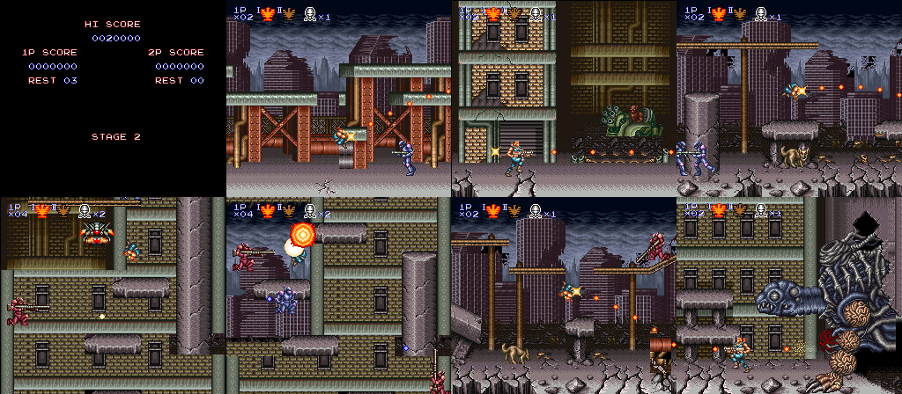
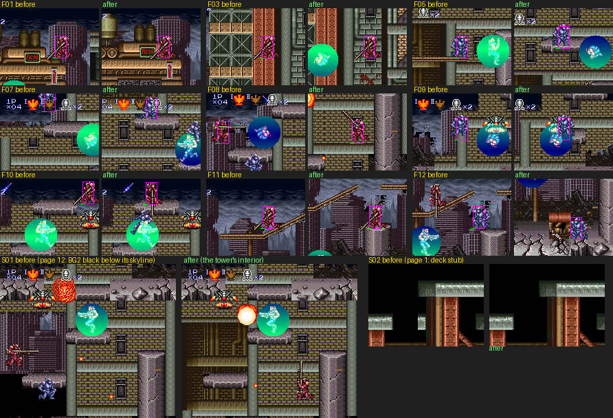

# Stage 2: Collapsed Tower

The stage that the extra-stage build (`make cheats CHEATS=extra_stage`,
see [Adding a stage](adding-a-stage.md)) inserts as stage 2, between the
city of stage 1 and the top-down highway (now stage 3). The default ROM
does not have it: everything below is assembled only with
`CHEAT_EXTRA_STAGE`.

```sh
make cheats CHEATS=extra_stage                        # build/contra3-mod.sfc
make cheats CHEATS="extra_stage start_stage=2"         # straight to it
make cheats CHEATS="extra_stage start_stage=2 invincible no_pit_death infinite_lives"
make stage-test                                       # tests/test_extra_stage.py
```



## The route

Past stage 1's burning city, the soldiers fall back through the industrial
district into the ruins of a skyscraper district, climb the shell of a
tower that came down across the street, cross the rubble on top and meet
the turtle again, this time in its home block.

Nineteen pages of BG1 (`assets/wram/extra_bg1_map.map`, page 19 is blank):

| pages | section | what happens |
|---|---|---|
| 0-4 | the industrial street | girder decks over the street (two levels to fight on), the cafe, pipe towers; grenade soldiers on the decks and in the street, a sniper on the cafe's roof and one in a window, pop-up turrets, alien dogs, foot soldiers from both edges (`OBJT_SOLDIER_SPAWNER`, deleted on page 4), three weapon capsules |
| 5-7 | the mid-boss | the brick block of stage 1; flame geysers in the cracked street, then the mid-boss tank crashes down through the building (`OBJT_MIDBOSS_TANK`, its arena on page 7). Its death resumes the scroll and sets the checkpoint |
| 8-9 | the ruins | the continue starts on page 8; the green block gives way to rubble, power lines and a broken concrete pillar to climb over; more foot soldiers, a pop-up turret |
| 10-13 | the climb | at the end of page 9 the screen locks on page 10 and scrolls up (`bg1_scroll_mode` 2, then 3) through pages 11, 12 and 13: broken floor slabs to jump up through, two concrete pillars to climb, a power line to hang from; window snipers in its windows and grenade soldiers on the slabs come down into view from above, a capsule flies across. The climb goes up the face of the tower: its olive brick floors and windows, torn open on the way (pages 11 and 12) to show the dark interior |
| 13-16 | on top | at the top of page 13 the stage scrolls right again over the fallen slabs, power poles and pillars of the ruins; grenade soldiers, dogs, a turret, a capsule |
| 17-18 | the boss | stage 1's boss block: the turtle bursts through the wall (`OBJT_STAGE1_BOSS_CONTROLLER`, its arena on page 18); its death ends the stage |

The whole map as the stage travels it, with the spawn markers (the
gallery's [extra_bg1](gallery.md#extra_bg1); pages 11-13 are drawn above
page 10):

<div style="overflow-x: auto"><a href="gallery/levels/extra_bg1.png"></a></div>

## Design

- **Pace.** Two flat sections (the street, the ruins on top), each with a
  set piece at its end (the tank, the turtle), around a vertical stretch in
  the middle, so that the stage does not feel like stage 1 played again
  although it uses its graphics: stage 1 never leaves the street.
- **The climb** (pages 10-13) is built on the jump: the players jump 69
  pixels (measured in the emulator from the street), so every slab is 64
  pixels above the one before, and either overlaps it (jumped through from
  below: the slabs are `TILE_PLATFORM`, collision class 2) or starts where
  it ends (a jump to the side). Two routes cross it: the slabs, and the
  concrete pillars (`TILE_CLIMBABLE`, class 1), climbed with Up to their
  tops; one pillar stops more than 100 pixels below the next, so that the
  next one is not grabbed from the first one's top as a ceiling (the first
  draft had them 48 pixels apart, and the player hung under it). The last slab is high on page 13, so
  that standing on it pulls the screen to the top (`bg1_scroll_vertical`
  scrolls while a player is above `scroll_threshold`), where the stage
  turns right again. A fall off the bottom of the screen kills, as on
  stage 3's climbs, and as there `respawn_mode` is 4 during the climb
  (`OBJT_RESPAWN_CLAMP_TRIGGER` on page 10, back to 0 on page 13).
- **The look of the climb.** Pages 10-13 show the tower it climbs: the
  olive brick building of the boss's block (stage 1's pages 26-27, this
  stage's 17-18: brick, windows, cornices and ledges, the green corner
  pillars), so the tower climbed is the block the turtle waits in; its storeys at the
  same 64 pixels as the slabs, so that every slab sits under a cornice like
  a broken floor. On page 11 the facade is torn away and the dark interior
  wall with its pipes (stage 1's metatiles `06C`-`073`) shows behind the
  power line, and again on page 12 behind a slab (the first draft had a
  hole through to the skyline there: see the visual review below); a storey stands broken
  off above the roof on page 13, and the facade's crest is rubble. It is a
  backdrop only: a slab, pillar or power-line metatile whose tiles are
  blank (`$0260`) gets the wall's tiles there, in a new metatile (the
  extra stage's own, from `$1A8`); every tile with a collision class is
  the one it was, at the same place, so the collision map of the climb is
  the same tile for tile (checked when the map was made), and the
  characters used are all below `$391` (no class) and outside
  `$080`-`$0FF` (replaced at the mid-boss), with no priority bit (the
  players and the enemies stay in front). The few pixels that the slabs'
  rounded ends leave transparent show BG2, as stage 1's do.
- **Fairness.** Enemies come in one at a time at first, the alien dogs at
  least 1.5 pages apart (they all take the one slot `$0280`: see below),
  weapon capsules in every section (nine in the stage's lists, three more
  in the lists of stage 1's it reuses), and the checkpoint right after the
  mid-boss.
  The same simple scripted player that runs and fires dies on stage 1 and
  on this stage alike (three lives lost by stage 1's page 4, by this
  stage's page 2: its first section is a little busier).

## How it is built

All of it goes through the asset pipeline and the per-stage tables of
`src/game/stages.inc` (the arguments for the extra stage, see
[Adding a stage](adding-a-stage.md)):

| what | the extra stage's | reused from |
|---|---|---|
| BG1 map | `assets/wram/extra_bg1_map.map` (`extra_bg1_map`, in bank `$04`: `src/game/extra_stage.asm`) | arranged from stage 1's metatiles; pages 6-7 and 17-18 are stage 1's 16-17 and 26-27, the arenas the mid-boss and the boss write into (`vram_blocks_05ACDF`, the boss's wall blocks and its `TILE_WALL` column) |
| metatiles, BG2 map | `load_list_extra_maps`; 34 metatiles of its own, `$1A8`-`$1C9` (`assets/wram/extra_bg1_metatiles.metatiles`, `extra_bg1_metatiles`, bank `$04`, decompressed to `$7E:8500` right after stage 1's second stream) | stage 1's (`stage1_bg1_metatiles`, `stage1_bg1_metatiles_2`, `stage1_bg2_metatiles`, `stage1_bg2_map`); its own are made of stage 1's characters |
| BG and sprite tiles, start and checkpoint | `load_list_extra_vram` | stage 1's BG tiles, and the sprites stage 1 has from its page 1 on (it loads `load_list_059E62` there), so every enemy used is drawn in both halves |
| spawn lists | `assets/stages/extra.spawns` (`spawn_pages_extra`) | pages 6, 17 and 18 use stage 1's lists of its pages 16, 26 and 27 (`spawn_list_0596CA`, `spawn_list_05979C`, `spawn_list_0597DA`: the tank, the boss and its scroll stop) |
| start | `layout_init_extra` (bank `$00`, 4 bytes) and `layout_init_extra_far` (bank `$04`) | stage 1's set-up: the BG2 tank's HDMA and `bg2_scroll_mode` 4; from the checkpoint `bg2_scroll_mode` 5 |
| map offsets | BG1 page 0, page 8 from the checkpoint; BG2 page 0 | |
| music | `stage_songs`: entry 5 | stage 5's song set (`song_set_stage5`, its samples) and song (`SOUND_SONG_STAGE5`): the sound effects and the boss song use only the common instruments (`$00`-`$13`), so they sound the same over any stage's samples |
| direct page parameters (collision thresholds), palettes, respawn mode, stage clear picture | | stage 1's |

The sections' graphics follow what stage 1 loads as it goes: the BG
characters `$80`-`$FF` are replaced at the mid-boss
(`OBJT_LOAD_LIST_TRIGGER` `0002`, the tank's building on BG2), so every
page after it uses metatiles without those characters (the ruins' are all
above `$180`); the boss's `0000` replaces `$000`-`$17F` for its block. The
BG2 screens are stage 1's in the same order (page 0 at the start, the
tank's screen, page 0 again after it, with parallax, the boss's screen).

**Bank `$05`.** The spawn lists and the two load lists take 678 bytes of
bank `$05`, more than the room the move of `half_turn_sine` had made: the
extra-stage build also moves `td_spawn_offsets_y` and
`td_spawn_offsets_x` (640 bytes, read only by
`td_place_enemy_near_player`) to bank `$04` and reads them there with long
addressing. Bank `$05` keeps 530 bytes free.

**The arenas' page parity.** `stage1_boss_controller_state_00` writes the
boss's wall column at a fixed place of the collision map (`$7E:4830`,
which is in the half of an odd page): the boss's arena must be at an odd
`bg1_x` page, from the start and from the checkpoint. The climb does not
move `bg1_x`, so the stage has 15 pages across to the arena (`bg1_x`
`$0F00`) and 7 from the checkpoint (`$0700`); after the climb `bg1_y` is
-768, a multiple of 256, so the boss's tilemap blocks land where they do
on stage 1.

## Visual review

After the stage was built, every page was reviewed for things that look
wrong (the review's working files are not tracked): each spawn placed in map
coordinates and checked against the collision under it and against how
stage 1 places the same type, then seen in the emulator when it appears
and 45 and 120 frames later (the scripted player of
`tools/c3emu/extra_stage.py`, not firing); the scenery page by page, in
the gallery's map and in the game. Two things decided most of it:
`OBJT_WINDOW_SNIPER` and `OBJT_GRENADE_SOLDIER` do not fall (their
handlers have no gravity: they stay where they spawn, `OBJ_Y` being their
feet), so their `y` must be a floor, a ledge or a window sill (stage 1's
stand on its girder decks, crates, the street, or in a bunker's window);
and BG2 (stage 1's skyline, still during the climb) is black below its
skyline, which a hole in BG1 shows whenever the climb brings it to the
lower quarter of the screen.



| | page, map x,y | what was wrong | severity | done |
|---|---|---|---|---|
| F01 | 2: 848,840 | sniper crouching in the air beside the cafe's roof | major | on the roof, at 828,848 |
| F02 | 3: 1056,872 | grenade soldier standing on top of a pipe tower (decoration, no floor) | major | in the street |
| F03 | 4: 1328,860 | sniper on the face of a girder column | major | in the green block's window, 1384,874 |
| F04 | 10: 2576,703 | sniper on the brick beside a window, half over the corner pillar | minor | in a window, 2600,688 |
| F05 | 10: 2704,560 | grenade soldier standing on the power line (a bar the players hang from) | medium | on the slab at 2712,464 |
| F06 | 11: 2792,463 | sniper over the right corner pillar | minor | in a window, 2728,560 |
| F07 | 11: 2624,368 | grenade soldier in the air under a slab | major | on the slab at 2640,400 |
| F08 | 11: 2576,319 | sniper in the air in the hole | major | in a window, 2728,368 |
| F09 | 12: 2656,144 | grenade soldier in the air beside the pillar | major | on the slab at 2712,144 |
| F10 | 12: 2792,79 | sniper in the sky over the broken storey | major | on the top slab, 2736,80 |
| F11 | 15: 3392,72 | sniper on the slanted power line | medium | on the concrete pillar's top, 3472,112 |
| F12 | 15: 3456,104 | grenade soldier in the air | major | in the street, 3424,200 |
| S01 | 12: 2560-2656, 248-391 | the hole to the skyline shows BG2's black under it: a black box at the bottom of the screen during the climb | major | the tower's interior (stage 1's `06C`-`073`, and the slab over it in `1C8`, `1C9`), brick under and over it (no collision changed) |
| S02 | 1: 416,872 | 8 pixels of girder deck alone in the air (the end of a deck in stage 1's metatile `056`) | minor | `1C7`, `056` without it (one `TILE_PLATFORM` tile less, nothing stood on it) |

Map x,y: pixels of the gallery's picture above (`bg1_x` plus the
screen x; y 0 is the top of page 13, the street of pages 0-10 is at 968);
the enemies' at their feet.

Seen and left as they are: the power lines end in the air at their ends
and step between poles (pages 9, 14-16), as stage 1's do; the slabs hide
the top of some windows of the facade; dark rubble at the foot of the
tower (page 10) and of the upper concrete pillar (page 11) has square
edges; on page 13 the cornice over the shaft looks like floor at its left
end, where the climb comes up; the pop-up turrets rise in front of the
cafe and a pipe tower (their crack is their own sprite, as on stage 1).
The positions of the sniper and grenade soldier spawns are checked by
`tests/test_spawns.py` (`test_extra_stage_standing_spawns`): each
one's feet on a collision tile, or in one of the windows listed there.

## Slots, triggers and what to keep when editing

- The climb's lists follow `bg1_y`: on a climb, the entries of a list not
  spawned when the screen moves on to the next page freeze the game
  (`spawn_stage_objects` flushes only positions 0 and 1 there), so an
  entry must find a free slot before its page ends.
- `OBJT_ALIEN_DOG` takes slot `$0280` only: two dogs close together freeze
  the game at the end of the page (found by the first play of the stage:
  `frame_counter` stopped at a page boundary).
- Stage 1's list of page 17 (`spawn_list_05979C`) puts its two capsules
  in slot `$0280` too, before the boss's controller: a dog still running
  there froze the game before the boss (seen with two players, 2 of 32
  start timings of the scripted player), so page 16 has a pop-up turret
  where it had a dog.
- The end of page 9 (`OBJT_SCROLL_MODES_TRIGGER` `0002` at `FE`) starts
  the climb with BG2 still; position `00` of page 13
  (`OBJT_SCROLL_MODES_TRIGGER` `0500`) turns right again, BG2 at 1/8.

## Testing

`tests/test_extra_stage.py` plays the stage with the scripted player of
`tools/c3emu/extra_stage.py` (run and fire, fight the arenas from the left,
the climb by waypoints, skipping ahead when a jump of the run has already
landed it on a higher slab; lives, bombs and the barrier kept up as in the
plays): from its start, from its checkpoint, with two players (2 PLAYERS
A), and from the start through a game over after the checkpoint and the
continue. Each run must see the mid-boss, the checkpoint, the climb to
`bg1_y` -768, the boss in its arena, the stage clear, the card "STAGE 3"
and the top-down stage 3. The other stages of the build play as the
original's, one stage later (their goldens).

**On real hardware.** The extra-stage build was played on a real SNES with
an FXPAK flash cartridge: stage 1, this stage 2 and the top-down stage 3
(the original stage 2), with no problems, and the stage was fun to play.
That checks the inserted stage, the renumbered stages and the variant's
moved tables on the console, not only in the emulator.
